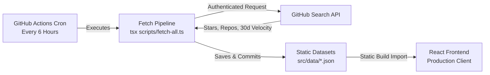

# DevSec Status

<div align="center">


**Automated developer intelligence dashboard tracking Programming Languages, Frameworks, Databases, Linux Distros, AI Systems, and Cybersecurity Tools.**

[](https://opensource.org/licenses/MIT)
[](https://devsec-status.vercel.app)
[](https://www.typescriptlang.org/)
[](https://react.dev/)
[](https://vitejs.dev/)
[](https://tailwindcss.com/)
[](https://github.com/sercanvr/devsec-status/actions)

</div>

---

## Overview

**DevSec Status** is an open-source developer intelligence dashboard designed to monitor the growth, developer adoption, repository volume, and velocity of major programming languages, modern frameworks, database engines, Linux distributions, AI systems, and cybersecurity toolkits.

Combining GitHub Search API metrics with a **finance-terminal-inspired UI**, DevSec Status visualizes technology popularity through interactive segmented metric bars, blueprint-styled architectural showcase heroes, dynamic community contributor stacks, and instant search filtering.

---

## Tech Stack

| Layer | Technology | Description |
|---|---|---|
| **Framework** | [React 19](https://react.dev/) | Core UI rendering with concurrent React features |
| **Bundler & Tooling** | [Vite 6](https://vitejs.dev/) & [TypeScript 5](https://www.typescriptlang.org/) | Next-generation frontend tooling and strict type checking |
| **Styling** | [Tailwind CSS 3](https://tailwindcss.com/) | Modern utility-first styling with custom glassmorphism and animations |
| **Routing** | [React Router 7](https://reactrouter.com/) | Client-side routing between Software and Security pages |
| **Localization (i18n)** | [i18next](https://www.i18next.com/) & [react-i18next](https://react.i18next.com/) | 9 languages (English, Turkish, German, French, Spanish, Italian, Portuguese, Russian, Chinese) with automatic browser detection |
| **Icons & Media** | [Lucide React](https://lucide.dev/) & WebP | Crisp scalable vector icons and lightweight WebP graphics |
| **Security & Sanitization** | [DOMPurify](https://github.com/cure53/DOMPurify) | DOMPurify sanitization for externally sourced data |
| **Testing** | [Vitest](https://vitest.dev/) & [Testing Library](https://testing-library.com/) | Unit, component, and dataset schema test suite |
| **Automation** | [GitHub Actions](https://github.com/features/actions) & `tsx` | Automated scheduled GitHub API fetch workflow every 6 hours |

---

## Key Features

- **Terminal & Fintech-Inspired UI**: Technology metrics visualized through 20-segment capsule progress bars with adaptive color tiers (Cobalt Blue, Emerald, Amber, Rose).
- **Blueprint Architecture Showcase**: High-impact hero container featuring SVG blueprint vectors, interactive sparkline charts, growth ratios, and a central orbital tech hub.
- **Granular Category Tables**: Full developer and security ecosystem organized across 8 dedicated tables (125 curated technologies total — 111 actively metric-tracked GitHub repositories and 14 upstream distributions/profiles marked `N/A`):
  - **Software Ecosystem** ([Software Page](https://devsec-status.vercel.app/)):
    - *Programming Languages* (28 core languages: Python, Rust, TypeScript, Go, C++, etc.)
    - *Frameworks & Libraries* (19 modern stacks: React, Next.js, FastAPI, Vue, Gin, etc.)
    - *Database Technologies* (15 relational, NoSQL, and vector engines: PostgreSQL, Redis, Supabase, MongoDB, SQLite, etc.)
    - *Linux Distributions* (11 core operating systems: Ubuntu, Debian, Arch, Fedora, Alpine, etc.)
    - *AI Tools & Agentic Frameworks* (12 application stacks: Ollama, LangChain, AutoGPT, ComfyUI, Open WebUI, CrewAI, etc.)
    - *AI Infrastructure & Runtimes* (12 deep learning & inference engines: PyTorch, TensorFlow, Transformers, llama.cpp, vLLM, JAX, etc.)
  - **Security & SecOps Ecosystem** ([Security Page](https://devsec-status.vercel.app/security)):
    - *Cybersecurity Tools* (21 SAST/DAST, scanners, and exploit frameworks: Ghidra, Metasploit, Nmap, Trivy, Nuclei, ZAP, etc.)
    - *Security Operating Systems* (7 penetration testing distributions: Kali Linux, Parrot OS, BlackArch, Tails, etc.)
- **Expandable Community Drawer**:
  - Notable project contributors & maintainers with interactive avatar cards and direct profile links
  - Top starred new repository of the month
  - Total ecosystem repository count and official release dates
  - Direct external repository navigation
- **Instant Search & Tag Filtering (`⌘K` / `Ctrl+K`)**: Global search modal supporting fuzzy name search, categories, creators, and hashtag syntax (e.g. `#framework`, `#systems`).
- **Multilingual Support (9 Languages - EN / TR / DE / FR / ES / IT / PT / RU / ZH)**: Instant switching across 9 global languages with CDN-optimized WebP flag preloading. *(Translations are AI-assisted; improvements from native speakers are warmly welcomed).*
- **Dark & Light Mode**: Seamless theme switching with persistent storage and system preference detection.
- **Zero Runtime API Latency & No Rate Limits**: Metrics are pre-fetched via automated GitHub Actions and served as static JSON from Vercel's Edge CDN, eliminating browser rate limits (403 errors) and third-party query latency.
- **AI Agentic & Search Engine Ready**: Built-in `sitemap.xml`, `robots.txt`, `llms.txt`, and `ai-catalog.json` for autonomous AI agents and web crawlers.
- **Responsive Standard**: Tested and optimized across Mobile (`390 x 844 px`), Tablet (`768 x 1024 px`), Laptop (`1366 x 768 px`), and Desktop (`1920 x 1080 px`).

---

## Project Structure

```
devsec-status/
├── .github/
│   ├── ISSUE_TEMPLATE/
│   │   └── suggest_technology.yml   # Template for suggesting new tools & tech
│   ├── workflows/
│   │   ├── ci.yml                   # CI PR verification (tests, schema integrity, build)
│   │   └── update-data.yml          # Automated 6-hour cron workflow for GitHub API sync
│   └── pull_request_template.md     # Standard pull request checklist
├── public/
│   ├── icons/                       # WebP brand logos, favicon, and country flags
│   ├── ai-catalog.json              # Structured manifest for autonomous AI agents
│   ├── llms.txt                     # Semantic dataset documentation for LLM ingestion
│   ├── robots.txt                   # Crawler directives
│   └── sitemap.xml                  # SEO URL index
├── scripts/
│   ├── fetch-all.ts                 # Unified metric synchronization for all 8 datasets
│   ├── fetch-languages.ts           # GitHub Search API crawler for languages
│   ├── fetch-frameworks.ts          # GitHub Search API crawler for frameworks
│   ├── fetch-databases.ts           # GitHub Search API crawler for databases
│   └── fetch-security-tools.ts      # GitHub Search API crawler for security tools
├── src/
│   ├── components/
│   │   ├── HeaderShowcase.tsx       # 3-column blueprint hero showcase card
│   │   ├── TechTable.tsx            # Modern fintech table with search, sort & drawers
│   │   ├── SegmentedProgressBar.tsx # 20-capsule segmented metric bar
│   │   ├── TechBar.tsx              # Standalone tech card component
│   │   ├── Navbar.tsx               # Navigation bar with search shortcut & theme toggle
│   │   ├── Footer.tsx               # Dynamic last-updated footer with GitHub star CTA
│   │   ├── SearchModal.tsx          # Keyboard-navigable quick search modal (Ctrl+K)
│   │   ├── LanguageSwitcher.tsx     # Instant language switcher with preloaded WebP flags
│   │   ├── ProximitySidebar.tsx     # Quick section anchor sidebar
│   │   ├── ScrollToTopButton.tsx    # Smooth scroll-to-top floating button
│   │   ├── InitialViewportVignette.tsx # First-visit session depth atmospheric vignette
│   │   ├── Skeleton.tsx             # Sunken well skeleton loader with metallic sheen
│   │   ├── ui/
│   │   │   └── skeleton.tsx         # Primitive Skeleton components (Block, Text, Circle, Swap)
│   │   └── CardSkeleton.tsx         # High-fidelity card shimmer loading skeleton
│   ├── data/                        # Master synced datasets (languages, frameworks, etc.)
│   ├── hooks/
│   │   ├── useGitHubContributors.ts # Contributor avatar resolver with fallback cache
│   │   └── useTheme.ts              # Dark/light theme state manager
│   ├── i18n/                        # 9 localization dictionaries (en, tr, de, fr, es, it, pt, ru, zh)
│   ├── lib/
│   │   ├── formatNumber.ts          # Locale-aware number and percent formatter
│   │   └── sanitize.ts              # DOMPurify text and URL sanitization helpers
│   ├── pages/
│   │   ├── SoftwarePage.tsx         # Main software ecosystem page (6 category tables)
│   │   └── SecurityPage.tsx         # Cybersecurity tools & SecOps page (2 category tables)
│   ├── types/
│   │   └── tech.ts                  # Core TypeScript interfaces for technologies & metrics
│   ├── App.tsx                      # Application root and route configuration
│   ├── main.tsx                     # React DOM entry point
│   └── index.css                    # Tailwind CSS directives and custom styling tokens
├── tests/
│   ├── dataIntegrity.test.ts        # Dataset schema, unique IDs, and HTTPS security checks
│   ├── TechTable.test.tsx           # Unit tests for fintech table filtering and expansion
│   ├── TechBar.test.tsx             # Unit tests for technology row rendering
│   ├── Skeleton.test.tsx            # Unit tests for skeleton loaders and fallback states
│   └── setup.ts                     # Jest DOM test environment setup
├── CONTRIBUTING.md                  # Comprehensive contribution and data guidelines
├── package.json
├── tailwind.config.js
├── tsconfig.json
└── vite.config.ts
```

---

## Data Pipeline & Architecture

DevSec Status avoids client-side GitHub API rate limits (60 requests/hour unauthenticated) by employing a **Static Build Data Sync** pattern:



1. **Scheduled Sync**: A GitHub Actions workflow triggers every 6 hours (`0 */6 * * *`) executing `pnpm run fetch:data` via `scripts/fetch-all.ts`.
2. **API Query**: All 8 datasets are traversed. For GitHub-hosted entries, repository metrics (stars, search volume, and 30-day velocity) are fetched using `GITHUB_TOKEN`.
3. **Commit & Push**: Updated metrics are verified and committed back to `src/data/*.json`.
4. **Edge CDN Delivery**: Data is bundled as static assets and served globally via Vercel's Edge CDN, eliminating browser rate limits and third-party query latency.

---

## Methodology & Data Transparency

- **Metrics Source**: Repository popularity metrics (stars, ecosystem repo count, 30-day velocity) reflect the linked open-source repository fetched via GitHub REST and Search APIs.
- **Repository Scope & Upstream Mirrors**: For technologies primarily maintained outside GitHub (e.g. Linux distributions such as Debian on Salsa, Fedora on Pagure, Arch on Arch GitLab, Tails on self-hosted GitLab, or Kali Linux build configurations), the linked repository represents the official upstream mirror, build configuration, or package tooling.
- **Non-GitHub Hosted Projects**: Projects without an active GitHub repository (e.g., Tails, CAINE) display `N/A (Not hosted on GitHub)` and are excluded from star-relative bar scaling to avoid comparative distortion.
- **Contributor Stack**: Displayed contributors represent notable maintainers and project contributors from pre-rendered datasets, avoiding client-side runtime API rate limits.

---

## Getting Started

### Prerequisites

- [Node.js](https://nodejs.org/) (version 20.x or higher recommended)
- [pnpm](https://pnpm.io/) (version 10.x recommended)

### Installation

1. **Clone the repository**:
   ```bash
   git clone https://github.com/sercanvr/devsec-status.git
   cd devsec-status
   ```

2. **Install dependencies**:
   ```bash
   pnpm install
   ```

3. **Configure Environment Variables (Optional for local data fetching)**:
   Create a `.env` file in the project root if you wish to run the data collection scripts locally:
   ```env
   GITHUB_TOKEN=ghp_your_personal_access_token_here
   ```
   *(Note: The web application itself runs entirely without environment variables as it reads from the pre-populated datasets).*

4. **Start the development server**:
   ```bash
   pnpm dev
   ```
   Open [http://localhost:5173](http://localhost:5173) in your browser.

---

## Available Scripts

| Command | Description |
|---|---|
| `pnpm dev` | Starts the Vite local development server with hot module replacement (HMR) |
| `pnpm build` | Type-checks with `tsc` and builds production bundle to `dist/` |
| `pnpm preview` | Serves the production build locally for verification |
| `pnpm lint` | Runs strict TypeScript type checks across all files (`tsc --noEmit`) |
| `pnpm test` | Runs the Vitest test suite once |
| `pnpm run fetch:data` | Executes scripts/fetch-all.ts to refresh static JSON metrics across all 8 datasets |

---

## Testing

The project uses [Vitest](https://vitest.dev/) with [React Testing Library](https://testing-library.com/docs/react-testing-library/intro/) for unit, component, and dataset schema validation.

To execute tests:
```bash
pnpm test
```

The test suite validates:
- **Dataset Schema Integrity (`tests/dataIntegrity.test.ts`)**: Verifies that all 8 static JSON files exist, contain valid arrays, have unique IDs across all datasets, and include all required fields.
- **Component & UI State Rendering (`tests/Skeleton.test.tsx`, `tests/TechTable.test.tsx`)**: Validates skeleton placeholders, accessibility labels, and table views.
- **Popularity & Progress Bars (`tests/TechBar.test.tsx`)**: Tests 20-segment popularity progress calculations and secure external navigation links.

---

## Contributing

Contributions make the open-source community an amazing place to learn, inspire, and create. Any contributions to **DevSec Status** are greatly appreciated!

For detailed guidelines, please read our [CONTRIBUTING.md](CONTRIBUTING.md).

### How You Can Contribute

- **Suggest a Technology**: Know a fast-growing open-source framework, database, AI system, or cybersecurity tool? Open an issue using the [Suggest a Technology Issue Template](https://github.com/sercanvr/devsec-status/issues/new?template=suggest_technology.yml) without needing to write code!
- **Add a Technology via Pull Request**: Add an entry directly to `src/data/<category>.json` following the schema below.
- **Translations (i18n)**: Review or refine translations in `src/i18n/` to ensure natural technical phrasing across all 9 supported languages. *(Translations are AI-assisted; native speaker contributions are warmly welcomed).*
- **UI / UX & Performance**: Propose design improvements, mobile responsiveness enhancements, or accessibility fixes.

### Adding a Technology Entry

In DevSec Status, technology metrics are refreshed automatically every 6 hours via GitHub Actions for projects hosted on `github.com`. When adding a new entry to `src/data/<category>.json`:

1. Ensure the technology is open-source. For GitHub-hosted projects, link the active public repository (`https://github.com/owner/repo`). Projects hosted elsewhere (e.g. GitLab, custom domains) or maintained as package distributions/orgs link to their respective upstream profile, and their popularity metrics remain at zero (rendered as `N/A`).
2. Provide only the essential metadata. You do **not** need to manually compute stars, repository totals, or 30-day velocity — initialize them with zeroes, and the automated cron workflow will populate them for GitHub repositories:
   ```json
   {
     "id": "tool-slug",
     "name": "Tool Name",
     "category": "security-tool",
     "subCategory": "Vulnerability Scanner",
     "iconUrl": "https://cdn.jsdelivr.net/gh/devicons/devicon/icons/python/python-original.svg",
     "githubUrl": "https://github.com/org/repo",
     "creator": {
       "name": "Author or Organization",
       "avatarUrl": "https://github.com/org.png",
       "type": "organization",
       "releaseDate": "2024",
       "latestVersion": "v1.0.0"
     },
     "popularity": {
       "totalRepos": 0,
       "totalStars": 0
     },
     "momentum": {
       "newReposLast30Days": 0,
       "topStarredNewRepo": null
     },
     "lastUpdated": "2026-10-13T00:00:00.000Z"
   }
   ```
3. **Icons & Fallbacks**:
   - Use official SVG icons from [Devicon CDN](https://devicon.dev/) (`https://cdn.jsdelivr.net/gh/devicons/devicon/icons/...`) or [SimpleIcons](https://simpleicons.org/) (`https://cdn.simpleicons.org/...`).
   - If an external icon fails to load, the interface automatically renders a clean fallback GitHub SVG icon.
4. **Creator Avatars**:
   - For organizations or authors with active GitHub profiles, use `https://github.com/<username-or-org>.png`.
5. **Run test verification**:
   ```bash
   pnpm test
   ```
   This ensures your entry meets the schema requirements and has a unique ID.

### Contribution Workflow

1. **Fork** the repository and create your branch (`git checkout -b feat/add-new-tool`).
2. **Make your additions** adhering to project conventions.
3. **Run tests** (`pnpm test`) to verify schema integrity.
4. **Commit your changes** following [Conventional Commits](https://www.conventionalcommits.org/) (`git commit -m "feat(data): add new technology entry"`).
5. **Push and open a Pull Request** targeting `main`.

---

## Contributors

Thank you to everyone who helps improve DevSec Status! Contributions of all kinds are credited directly in GitHub's official [Contributors](https://github.com/sercanvr/devsec-status/graphs/contributors) graph.

---

## License

This project is licensed under the **MIT License** — see the [LICENSE](LICENSE) file for details.

Copyright (c) 2026 **Sercan Var**.
